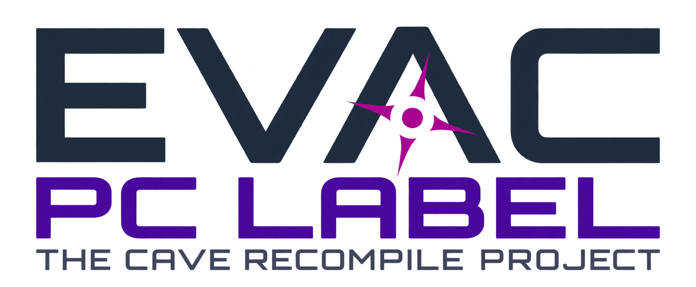
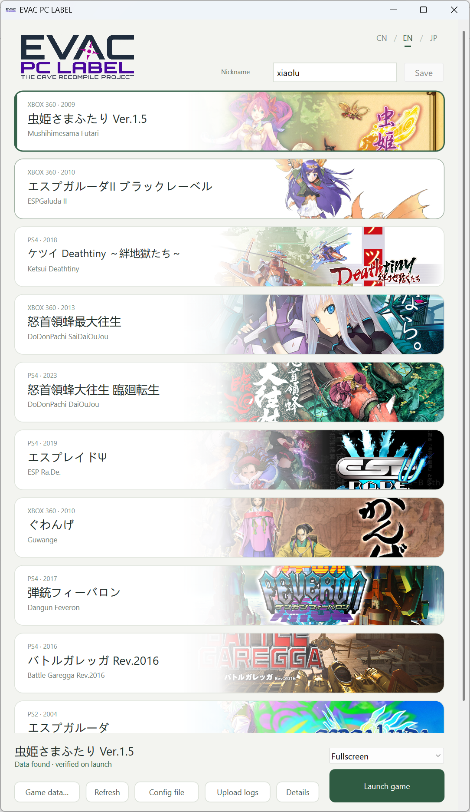

  

  <a href="README.md">简体中文</a> · <a href="README.en.md">English</a>

EVAC PC LABEL is an open-source project that ports classic shooters to PC with a unified launcher and play experience. Xbox 360 and PS2 titles use static recompilation. PS4 titles execute their original x86-64 code through a dedicated runtime, with CPU instruction translation where needed.

  <a href="https://github.com/zxl0714/EVAC-PC-LABEL/releases/latest"><strong>Download for Windows</strong></a> ·
  <a href="docs/GAME_DATA.en.md">Game data</a> ·
  <a href="docs/SETTINGS.en.md">Settings & controls</a> ·
  <a href="https://github.com/zxl0714/EVAC-PC-LABEL/releases">Release notes</a>

  

## Latency and performance

Representative workloads; lower is better. Latency is in milliseconds and CPU usage is in equivalent logical cores.

**Xbox 360**

The ports use 0V with Reflex enabled. Xenia uses the original game settings.

| Game | Port latency | Xenia latency | Port CPU | Xenia CPU |
| --- | ---: | ---: | ---: | ---: |
| Mushihimesama Futari | 10 | 36 | 0.07 | 1.28 |
| ESPGaluda II | 12 | 51 | 0.35 | 1.43 |
| DoDonPachi SaiDaiOuJou | 13 | 69 | 0.37 | 3.48 |
| Guwange | 13 | 66 | 0.29 | 3.13 |

**PS4**

| Game | Port latency | shadPS4 latency | Port CPU | shadPS4 CPU |
| --- | ---: | ---: | ---: | ---: |
| Ketsui | 17 | 55 | 0.25 | 0.62 |
| DaiOuJou | 17 | 55 | 0.26 | 0.34 |
| ESP Ra.De. | 20 | 46 | 0.38 | 0.62 |
| Dangun Feveron | 19 | 46 | 0.27 | 0.66 |
| Battle Garegga | 17 | 46 | 0.36 | 0.62 |

**PS2**

| Game | Port latency | PCSX2 latency | Port CPU | PCSX2 CPU |
| --- | ---: | ---: | ---: | ---: |
| ESPGaluda | 27 | 43 | 0.27 | 0.25 |
| Ibara | 32 | 43 | 0.36 | 0.27 |

Latency estimates include average sampling wait, game response and presentation, excluding device input, display scanout and panel response. CPU measurements use an i7-13700KF / RTX 4080. The two ESPGaluda CPU samples cover different scenes. [Test conditions and methods →](docs/PERFORMANCE.en.md)

## Supported games

| Platform | Games |
| --- | --- |
| Xbox 360 | [Mushihimesama Futari](docs/GAME_DATA.en.md#futari) · [ESPGaluda II](docs/GAME_DATA.en.md#espgaluda2) · [DoDonPachi SaiDaiOuJou](docs/GAME_DATA.en.md#sdoj) · [Guwange](docs/GAME_DATA.en.md#guwange) |
| PS4 | [Ketsui Deathtiny](docs/GAME_DATA.en.md#ketsui) · [DaiOuJou Re:Incarnation](docs/GAME_DATA.en.md#daioujou) · [ESP Ra.De. Ψ](docs/GAME_DATA.en.md#esprade) · [Dangun Feveron](docs/GAME_DATA.en.md#feveron) · [Battle Garegga Rev.2016](docs/GAME_DATA.en.md#garegga) |
| PS2 | [ESPGaluda](docs/GAME_DATA.en.md#espgaluda) · [Ibara](docs/GAME_DATA.en.md#ibara) |

Select a title for supported versions, extraction steps and folder examples. Prepare data only for the games you want to play.

## Getting started

Windows x64. Xbox 360 titles require Direct3D 12; PS4 and PS2 titles require Vulkan 1.3. Install your GPU vendor's graphics drivers.

1. **Download and extract** the [latest program package](https://github.com/zxl0714/EVAC-PC-LABEL/releases/latest). SHA-256 checksums are provided on the release page. Supply your own game data.
2. **Open `EVAC PC LABEL.exe`**, select a game, and choose **Game data… → Choose data folder…**. Select extracted game files for Xbox 360 / PS4, or the folder containing the original ISO for PS2.
3. **Click Launch game.** The launcher verifies the data and prepares runtime files on first launch.

Extract PS4 PKGs with the included `tools/Extract-PS4.exe`. For Xbox 360 ISOs, XBLA packages and DLC, see the [game data guide](docs/GAME_DATA.en.md). `Launch.bat` is an alternative launch entry.

## Settings and saves

Choose fullscreen or a window resolution, edit your leaderboard nickname, and switch languages with `CN / EN / JP` in the launcher. Use **Config file** for keyboard, controller, audio and online settings.

- **Controls:** arrow keys for movement, `Z / X / C / V` for the four controller face buttons, and `Enter` for Start. [All controls and special modes →](docs/SETTINGS.en.md#launcher-and-controls)
- **Low-latency settings:** [NEO](docs/SETTINGS.en.md#neo-mode) · [SDOJ Frame Delay](docs/SETTINGS.en.md#sdoj-frame-delay) · [G2 Frame Delay](docs/SETTINGS.en.md#g2-frame-delay)
- **Community leaderboards:** enabled by default, with no registration. Change `Player` to your own nickname before playing. [Rankings and replays →](docs/SETTINGS.en.md#community-leaderboards)
- **Updates and backups:** close the games and launcher before replacing program files. Keep the entire `user-data/` folder for settings, saves and replays. [Details →](docs/SETTINGS.en.md#updating-and-backups)

## Troubleshooting

After closing the game, click **Upload logs**, select the affected session, and briefly describe the problem. Include the resulting report ID in a [GitHub issue](https://github.com/zxl0714/EVAC-PC-LABEL/issues), with screenshots for visual problems.

Logs can also be uploaded when a game cannot start. **Details** shows missing data or runtime components and how to restore them. [Game data and version checks →](docs/GAME_DATA.en.md#troubleshooting)

## Development and credits

[Build guide (Chinese)](FOR_AGENT.md) · [Contributor instructions](AGENTS.md) · [Implementation plan (Chinese)](docs/IMPLEMENTATION_PLAN.md)

Built on ReXGlue/Xenia-related components, graphics components derived from shadPS4, PS2Recomp/paraLLEl-GS, SDL and other open-source work. [Source origins](docs/SOURCE_ORIGINS.json) · [ReXGlue license](third_party/rexglue/LICENSE) · [PS4 notices](third_party/ps4/THIRD_PARTY_NOTICES.txt) · [PS2 notices](third_party/ps2/THIRD_PARTY_NOTICES.txt) · [Artwork sources](launcher/artwork.json)

Components retain their respective licenses. Release packages include `licenses/` and `SOURCE.txt` with corresponding source and build information.
