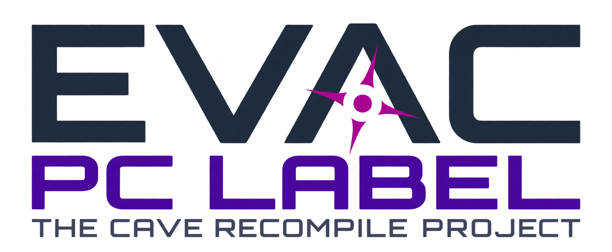
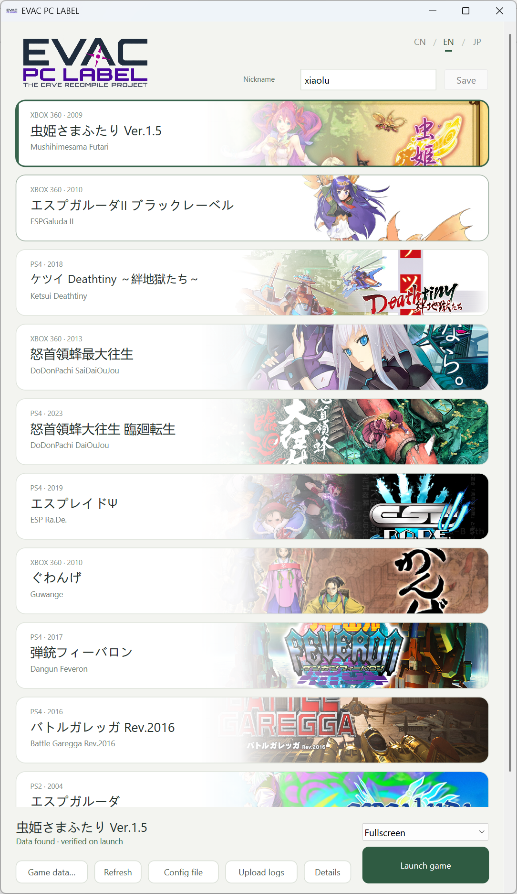

  

  <a href="README.md">简体中文</a> · <a href="README.en.md">English</a>

EVAC PC LABEL 是将经典射击游戏移植到 PC 的开源项目，提供统一的启动器和游玩体验。Xbox 360 和 PS2 游戏采用静态重编译；PS4 游戏通过专用运行时执行原始 x86-64 代码，并在需要时转换不兼容的 CPU 指令。

  <a href="https://github.com/zxl0714/EVAC-PC-LABEL/releases/latest"><strong>下载 Windows 版</strong></a> ·
  <a href="docs/GAME_DATA.md">游戏数据</a> ·
  <a href="docs/SETTINGS.md">设置与操作</a> ·
  <a href="docs/RELEASE_NOTES_v0.9.7.md">v0.9.7 更新说明</a>

  

## 延迟与性能

测试机为 i7-13700KF／RTX 4080。延迟为平均估算值（毫秒），CPU 为等效逻辑核数。三种平台都使用 `user-data/config.ini` 的 `[display]` 默认设置：`vsync = false`、`reflex = auto`。支持的 NVIDIA 显卡会自动启用 Reflex。

**Xbox 360**

虫姬二在游戏内选 0V，ESPGaluda II、最大往生和狱门山默认使用 0V（`frame_delay = 0`）。Xenia 使用原作档位。[虫姬二的 0V 菜单路径](docs/SETTINGS.md#虫姬二狱门山与-nvidia-reflex)

| 游戏 | 移植版延迟 | Xenia 延迟 | 移植版 CPU | Xenia CPU |
| --- | ---: | ---: | ---: | ---: |
| 虫姬二 | 10 | 36 | 0.07 | 1.28 |
| ESPGaluda II | 12 | 51 | 0.35 | 1.43 |
| 最大往生 | 13 | 69 | 0.37 | 3.48 |
| 狱门山 | 13 | 66 | 0.29 | 3.13 |

**PS4** · 五款游戏均使用默认 NEO 模式（`neo = true`）。

| 游戏 | 移植版延迟 | shadPS4 延迟 | 移植版 CPU | shadPS4 CPU |
| --- | ---: | ---: | ---: | ---: |
| 绊地狱 | 16 | 55 | 0.32 | 0.62 |
| 大往生 | 15 | 55 | 0.30 | 0.34 |
| ESP Ra.De. | 20 | 46 | 0.43 | 0.62 |
| 弹铳 | 17 | 46 | 0.36 | 0.66 |
| 空战之路 | 16 | 46 | 0.35 | 0.62 |

**PS2**

| 游戏 | 移植版延迟 | PCSX2 延迟 | 移植版 CPU | PCSX2 CPU |
| --- | ---: | ---: | ---: | ---: |
| ESPGaluda | 18 | 43 | 0.28 | 0.25 |
| 铸蔷薇 | 18 | 43 | 0.38 | 0.27 |

延迟从输入到达电脑算到 Windows 显示事件。设备上报和显示器响应另计。[测试条件与计算方法 →](docs/PERFORMANCE.md)

## 支持游戏

| 平台 | 游戏 |
| --- | --- |
| Xbox 360 | [虫姬二](docs/GAME_DATA.md#futari) · [ESPGaluda II](docs/GAME_DATA.md#espgaluda2) · [最大往生](docs/GAME_DATA.md#sdoj) · [狱门山](docs/GAME_DATA.md#guwange) |
| PS4 | [绊地狱](docs/GAME_DATA.md#ketsui) · [大往生](docs/GAME_DATA.md#daioujou) · [ESP Ra.De. Ψ](docs/GAME_DATA.md#esprade) · [弹铳](docs/GAME_DATA.md#feveron) · [空战之路](docs/GAME_DATA.md#garegga) |
| PS2 | [ESPGaluda](docs/GAME_DATA.md#espgaluda) · [铸蔷薇](docs/GAME_DATA.md#ibara) |

点击游戏名查看支持的版本、解包方法和目录示例。只需准备想玩的游戏数据。

## 开始游玩

Windows x64。Xbox 360 游戏自动选择 Direct3D 12 或 Vulkan。PS4 和 PS2 游戏需要 Vulkan 1.3。

1. **下载并解压**[最新程序包](https://github.com/zxl0714/EVAC-PC-LABEL/releases/latest)，发布页提供 SHA-256 校验文件。游戏数据自行准备。
2. **打开 `EVAC PC LABEL.exe`**，选中游戏，点击“游戏数据…”→“选择数据目录…”。Xbox 360、PS4 选择已解包的游戏目录；PS2 选择原始 ISO 所在目录。
3. **点击“启动游戏”**。首次启动会校验数据并自动准备运行文件；后续启动和更新会复用未变化文件的校验结果。

PS4 PKG 可用随包的 `tools/Extract-PS4.exe` 提取；Xbox 360 ISO、XBLA 和 DLC 的处理方法见[游戏数据指南](docs/GAME_DATA.md)。备用启动入口为 `Launch.bat`。

## 配置与存档

在启动器中选择窗口分辨率或全屏，设置排行榜昵称，用 `CN / EN / JP` 切换语言。启动器关闭时会记住窗口大小。键盘、手柄、音量和联网设置通过底部“配置文件”编辑。

- **操作**：方向键移动，`Z / X / C / V` 对应手柄四个主按钮，`Enter` 为 Start。[完整按键与特殊模式 →](docs/SETTINGS.md#配置与操作)
- **Radeon 玩家**可在 `[display]` 下设 `amd_anti_lag = true` 试用 Anti-Lag 2，标准包默认关闭。[设置说明](docs/SETTINGS.md#amd-radeon-anti-lag-2)
- **低延迟设置**：[NEO](docs/SETTINGS.md#neo-模式) · [最大往生 Frame Delay](docs/SETTINGS.md#最大往生-frame-delay) · [G2 Frame Delay](docs/SETTINGS.md#g2-frame-delay)
- **社区排行榜**：默认联网，无须注册。先把默认昵称 `Player` 改为自己的名字。[排行榜与录像 →](docs/SETTINGS.md#社区排行榜)
- **更新与备份**：关闭游戏和启动器后覆盖程序文件，保留整个 `user-data/`，其中包含配置、存档和录像。[详细说明 →](docs/SETTINGS.md#更新与备份)

## 遇到问题

退出游戏后，点击启动器底部“上传日志”，选择对应的一局并简单描述问题。上传成功后，向 [Issues](https://github.com/zxl0714/EVAC-PC-LABEL/issues) 提供报告编号；如有画面异常，可附截图。

无法启动时也能上传日志。“详情”会显示缺少的数据或运行组件及处理方法。[数据识别与版本检查 →](docs/GAME_DATA.md#无法识别时怎么检查)

## 开发与致谢

[开发与构建](FOR_AGENT.md) · [贡献约定](AGENTS.md) · [实施计划](docs/IMPLEMENTATION_PLAN.md)

项目基于 ReXGlue／Xenia 相关组件、shadPS4 派生图形组件、PS2Recomp／paraLLEl-GS、SDL 等开源工作。[源码来源](docs/SOURCE_ORIGINS.json) · [ReXGlue 许可](third_party/rexglue/LICENSE) · [PS4 组件声明](third_party/ps4/THIRD_PARTY_NOTICES.txt) · [PS2 组件声明](third_party/ps2/THIRD_PARTY_NOTICES.txt) · [素材来源](launcher/artwork.json)

各组件保留各自许可证。发行包的 `licenses/` 包含许可证，`SOURCE.txt` 提供对应源码与构建说明。
