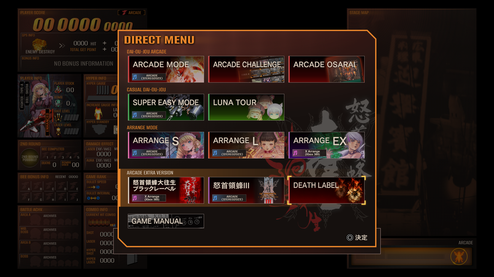
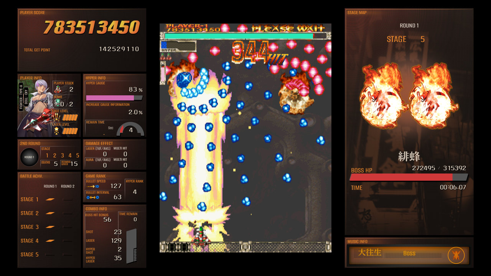

# EVAC PC LABEL v0.10.0

- 新增 PS2 日版《怒首领蜂大往生》。将 ISO 放入 `game-data/daioujou-ps2/`，即可从启动器游玩。
- 准备好 PS2《大往生》的数据后，PS4《大往生》会自动新增 **Death Label** 模式。我们也适配了仪表盘，希望你能喜欢。
- 韩版《空战之路 Rev.2016》增加英语翻译功能，默认打开。在 `user-data/config.ini` 的 `[game.garegga]` 下设置 `english_translation = false`，重启游戏即可切回韩文。[#21](https://github.com/zxl0714/EVAC-PC-LABEL/issues/21)
- 《ESP Ra.De. Ψ》和《空战之路》支持更多游戏数据类型。[#11](https://github.com/zxl0714/EVAC-PC-LABEL/issues/11) · [#21](https://github.com/zxl0714/EVAC-PC-LABEL/issues/21)

## English

- Added the Japanese PS2 release of DoDonPachi DaiOuJou. Place its ISO in `game-data/daioujou-ps2/` and start it from the launcher.
- The PS4 edition of DaiOuJou automatically adds **Death Label** when the PS2 game data is ready. We adapted the Gadgets for this mode and hope you enjoy them.
- Added an English translation for the Korean release of Battle Garegga Rev.2016, enabled by default. To switch back to Korean, set `english_translation = false` under `[game.garegga]` in `user-data/config.ini` and restart the game. [#21](https://github.com/zxl0714/EVAC-PC-LABEL/issues/21)
- Added support for more game data formats for ESP Ra.De. Ψ and Battle Garegga. [#11](https://github.com/zxl0714/EVAC-PC-LABEL/issues/11) · [#21](https://github.com/zxl0714/EVAC-PC-LABEL/issues/21)

## Death Label

