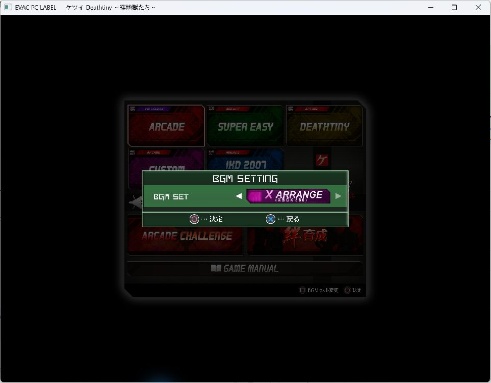

# EVAC PC LABEL v0.9.10

- 绊地狱新增 **X Arrange (Xbox 360)** 曲集，适用于 PS4 01.00 和 01.02。在 `game-data/ketsui/x-arrange/` 放入 Xbox 360 版的曲目后，即可在 **BGM SET** 选择。[放置说明](GAME_DATA.md#ketsui)
- 改善 PS4 游戏数据识别兼容性，支持缺少或更换系统封面、背景图的导出数据。
- 修复虫姬二切换存储设备时的崩溃。
- 修复 PS4 游戏窗口缩放时可能崩溃的问题。
- 修复启动器自动更新识别。使用 v0.9.9 的玩家可从 GitHub 下载本版程序包更新。

## English

- Added **X Arrange (Xbox 360)** music for Ketsui on PS4 versions 01.00 and 01.02. Place the Xbox 360 tracks in `game-data/ketsui/x-arrange/` and select the set in **BGM SET**. [File placement](GAME_DATA.en.md#ketsui)
- Improved PS4 game-data recognition for exports with missing or different system cover and background art.
- Fixed a crash when selecting a storage device in Mushihimesama Futari.
- Fixed a crash that could occur while resizing a PS4 game window.
- Fixed automatic update detection in the launcher. Players on v0.9.9 can download this release from GitHub to update.

